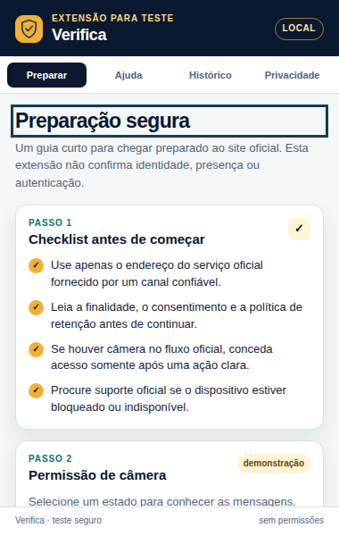

# Testar o Verifica 0.1.1 no Google Chrome

O ZIP é um pacote de distribuição dos arquivos, não uma instalação automática. Para o teste local no Chrome, **extrair o ZIP e carregar a pasta sem compactação**. O manifesto precisa ficar na raiz da pasta selecionada. Não abrir `popup.html` como arquivo comum nem arrastar o ZIP esperando uma instalação publicada. [1]

## 1. Conferir o pacote antes de extrair

Baixar `verifica-extensao-teste-0.1.1.zip` e o respectivo `.zip.sha256`. No PowerShell, na pasta dos downloads, executar:

```powershell
Get-FileHash .\verifica-extensao-teste-0.1.1.zip -Algorithm SHA256
Get-Content .\verifica-extensao-teste-0.1.1.zip.sha256
```

Comparar o digest completo, ignorando somente a diferença de maiúsculas/minúsculas. Se for diferente, parar e obter novamente o pacote por canal confiável. A checagem confirma igualdade dos bytes, não assinatura, autoria ou segurança quando ZIP e hash puderem ser trocados juntos.

No Explorador de Arquivos, clicar com o botão direito no ZIP e escolher **Extrair Tudo**. Manter a pasta em local estável, por exemplo `Documentos\Verifica-teste`. Conferir se ela contém `manifest.json`, `popup.html`, `popup.js`, `popup.css` e `icons`. O diretório `docs` é documentação; não é a pasta para carregar.

## 2. Carregar e abrir o popup real

1. Abrir uma janela normal do Chrome com perfil de teste, não uma sessão com documentos ou contas sensíveis.
2. Digitar `chrome://extensions` na barra de endereços.
3. Ativar **Modo do desenvolvedor**.
4. Clicar em **Carregar sem compactação** e selecionar a pasta que contém `manifest.json` diretamente.
5. Conferir no cartão o nome **Verifica — teste seguro**, a versão **0.1.1** e a ausência de erro impeditivo de carregamento.
6. Abrir o menu de extensões e fixar o Verifica. Clicar no ícone do escudo para abrir o popup. [1]

Se houver política corporativa bloqueando instalação local, procurar a administração do dispositivo. Não desativar controles corporativos nem adicionar permissões para contornar o bloqueio.

O pacote não tem service worker. A ausência de link de inspeção de um service worker não é defeito: a interface funciona somente pelo popup. Não conceder acesso a sites, câmera ou abas para “corrigir” isso.

## 3. Percorrer os fluxos e registrar o resultado

Em **Preparar**, ler os avisos e selecionar os estados concedida, negada e bloqueada. A mensagem deve mudar e continuar marcada como simulação. Não deve aparecer pedido de câmera, prévia facial ou captura. O upload de verificação continua indisponível sem provedor autorizado.

Em **Ajuda**, testar um endereço inválido, como `http://example.com/`: o link deve continuar oculto. Informar `https://example.com/` e clicar em **Validar formato**: isso deve mostrar o link manual, sem navegar. Alterar o campo depois: o link deve ser invalidado até nova validação. Testar endereço com query ou fragmento: deve ser recusado. Não clicar no link neste roteiro; formato válido não comprova que o domínio é oficial.

Em **Histórico**, conferir que o histórico real está vazio e separado dos exemplos. Buscar um domínio fictício, testar busca sem correspondência, abrir a confirmação de limpeza, cancelar, confirmar limpeza e restaurar. Somente os exemplos devem mudar; nenhuma ação registra autenticação real.

Em **Privacidade**, ler retenção e limites. Testar navegação com Tab, Shift+Tab e Enter. O foco precisa ficar visível; a região de conteúdo rolável entra na navegação por teclado. Conferir acesso ao conteúdo inferior sem mouse e ausência de título oculto ao trocar de tela.

Fechar o popup clicando fora dele e abrir novamente pelo ícone. O estado deve voltar à demonstração inicial, com exemplos restaurados e campos vazios. Fazer esse teste com o DevTools fechado. Uma página `chrome-extension://…/popup.html` aberta numa aba permite inspeção, mas não substitui o ciclo de abrir/fechar do popup da barra de ferramentas.

Registrar data, versão do Chrome obtida em `chrome://version`, versão da extensão, sistema operacional, resultado de cada fluxo e defeitos encontrados. Não inserir nome, CPF, imagem, senha ou token nos testes.

## 4. Inspecionar Console e Network

Com o popup aberto, clicar com o botão direito dentro dele e escolher **Inspecionar**. No DevTools, abrir **Console** e executar os fluxos. Conferir se aparecem exceções JavaScript. Em `chrome://extensions`, o botão **Erros**, quando presente, ajuda a localizar erros de carregamento/runtime. [1] [2]

Na aba **Network**, recarregar o popup dentro do contexto inspecionado e repetir o roteiro. Recursos locais `chrome-extension://` de HTML, CSS, JS e ícones são esperados. Não devem existir chamadas HTTP/HTTPS de API ou telemetria originadas pelo popup. Não confundir tráfego de outras abas ou a navegação manual de um link com um POST de autenticação da extensão. A documentação do Chrome orienta recarregar o popup com Network aberto para observar pedidos iniciais. [2]

Fechar DevTools e repetir abertura/fechamento, foco e rolagem no popup normal. Não colar código desconhecido no console e não executar comandos que alterem verificação, permissões ou dispositivos de câmera.

## 5. Atualizar e remover

Depois de trocar o pacote por uma nova versão, substituir os arquivos na pasta de teste ou carregar outra pasta conscientemente e remover a instalação antiga para não testar a versão errada. Quando o manifesto mudar, clicar em **Recarregar** no cartão da extensão. Fechar e abrir novamente o popup para carregar seus arquivos atualizados. [1]

Para encerrar, usar **Remover** em `chrome://extensions`. Isso não modifica autenticações oficiais, porque o pacote não se integrou a um serviço real.

## Resultados já observados e o que falta

A versão 0.1.1 foi auditada em Chromium 156.0.8078.47, em perfil temporário no sandbox, com axe-core 4.14.0. Foram percorridos 12 estados: zero violações automáticas, zero falhas complementares de navegação por teclado e três ocorrências de contraste inconclusivo nos mesmos símbolos decorativos de Preparação. Leitor de tela, análise humana desses símbolos e instalação no Chrome do Windows ainda precisam ser realizados pela equipe. Não é certificação WCAG nem teste de autenticação real.



## Se o serviço informar “câmera já em uso”

A captura recebida informa “Problema ao encriptar a câmera”, aponta “Câmera já em uso” como possível problema e pede para fechar outra aplicação. Isso é a mensagem do serviço, não um diagnóstico técnico confirmado nem prova de que a extensão ocupou a câmera. A extensão Verifica 0.1.1 não pede câmera, não captura vídeo e não cria webcam virtual.

Fechar normalmente apps e abas que estejam usando a câmera, como reunião de vídeo ou o app Câmera do Windows. Se a prévia de webcam do protótipo web estiver ativa, encerrar a câmera nessa tela ou fechar a aba antes de tentar o serviço oficial novamente. Não encerrar uma reunião importante sem avisar nem forçar encerramento de processos desconhecidos. A Microsoft recomenda verificar conflitos com outros apps quando a câmera falha numa aplicação específica. [3]

Conferir a permissão do **site oficial esperado** em Chrome → Configurações → Privacidade e segurança → Configurações do site → Câmera. Revisar apenas esse destino e selecionar a câmera real correta; não liberar todos os sites nem substituir a fonte por imagem ou webcam virtual. [4]

No Windows 11, conferir Configurações → Privacidade e segurança → Câmera. No Windows 10, o caminho fica em Privacidade → Câmera. O controle de acesso para aplicativos desktop pode afetar vários apps, não apenas o Chrome; ler o alcance do ajuste antes de habilitá-lo. Se estiver bloqueado pela administração, procurar o responsável pelo dispositivo. [5]

Retornar ao fluxo oficial depois de liberar a câmera. Se continuar aparecendo “encriptar a câmera” ou bloqueio de ações suspeitas, registrar navegador/versão, site e a mensagem e contatar o suporte oficial. Não desativar antivírus, proteções de verificação ou detecção de ações suspeitas para contornar o erro. Sem conhecer o site/aplicação e seu contrato, não afirmar que permissões ou câmera ocupada sejam a única causa.

## Referências

[1]: https://developer.chrome.com/docs/extensions/get-started/tutorial/hello-world "Chrome: carregar, fixar, inspecionar e atualizar extensão local"
[2]: https://developer.chrome.com/docs/extensions/get-started/tutorial/debug "Chrome: depuração de popup, erros e requisições"
[3]: https://support.microsoft.com/en-us/windows/hardware/camera/camera-doesn-t-work-in-windows "Microsoft: câmera não funciona e conflitos com outras aplicações"
[4]: https://support.google.com/chrome/answer/2693767?hl=en&co=GENIE.Platform%3DDesktop "Google Chrome: permissões de câmera por site"
[5]: https://support.microsoft.com/en-us/windows/privacy/manage-app-permissions-for-a-camera-in-windows "Microsoft: permissões de câmera e aplicativos desktop"
